# Propzen: Architecture Documentation

Last updated: Oct 11, 2026

Propzen is a web property marketplace: customers search for property to buy or rent, dealers list properties and receive enquiries, and admins keep listings clean. This document starts with the database, walks through each user workflow, and then covers the launch architecture, how it handles 500+ concurrent users, and what can wait until later.

## 1. Database schema at a glance

Propzen stores everything in 14 tables, grouped into six areas. The `accounts` table sits in the middle: almost every other table points back to it. Each arrow below means "this table points to that one": the table at the start of the arrow stores the other table's `id` in one of its columns.

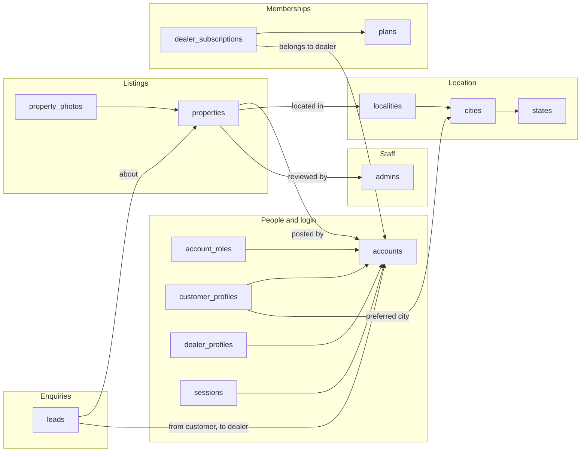

### How the tables connect

- **Location:** each locality belongs to a city, and each city to a state. Every property points to one locality, so search by place never relies on free-typed addresses.
- **People and login:** `accounts` holds one row per person who logs in, customers and dealers alike. `account_roles` says what each person may do, and one person can be both a customer and a dealer. `customer_profiles` and `dealer_profiles` hold details that only one kind of user needs. `sessions` holds one row per logged-in browser.
- **Staff:** `admins` is a separate table with its own login, so a customer account can never become an admin. Admins connect to the rest only by reviewing properties.
- **Listings:** each property is posted by one dealer account and sits in one locality. It has many photos, and each photo row points back to its property. The photo files themselves live in S3.
- **Enquiries:** a lead links three things: the customer who asked, the property they asked about, and the dealer who receives it.
- **Memberships:** each dealer subscription links one dealer to one plan, with start and end dates.

### Terms used in this document

| Term | Meaning |
| --- | --- |
| Table | A list of records of one kind, like a spreadsheet tab |
| Column | One piece of information each record has, like `price` |
| Primary key (PK) | The column that uniquely identifies each row, usually `id` |
| Foreign key (FK) | A column that stores another table's `id`, which is how tables connect |
| One-to-many | One row links to many rows, for example one property has many photos |
| One-to-one | One row links to at most one row, for example one account has at most one dealer profile |
| Index | A lookup structure that lets the database find rows quickly without reading the whole table |

## 2. Database foundation: tables and columns

This diagram shows the same 14 tables with their columns. Column names are what the code reads and writes, and the table after the diagram points out the few columns that need special care.

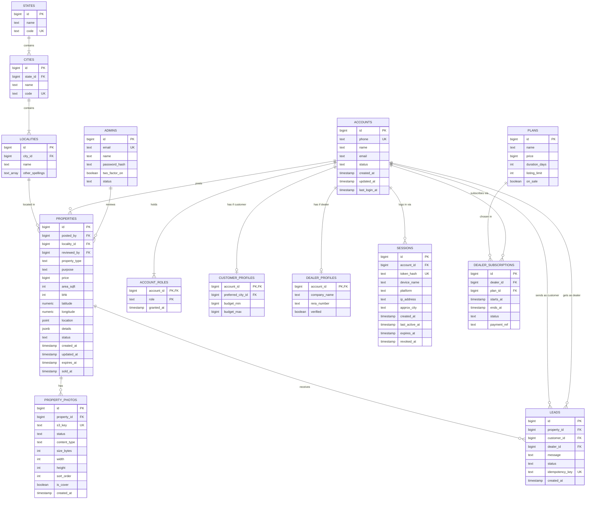

PK is the primary key, FK links to another table, and UK must be unique. The labelled lines read as sentences, for example "an account posts properties" or "a property receives leads."

### What each table holds

| Area | Table | Holds | Key notes |
| --- | --- | --- | --- |
| Location | states | Indian states | `code` such as "KA" |
| Location | cities | Cities within a state | `code` such as "BLR" |
| Location | localities | Neighbourhoods within a city | `other_spellings` catches "White Field" for "Whitefield" |
| People | accounts | One row per person who logs in (customers and dealers) | Phone is unique but never the primary key; `status` is `active`, `suspended` or `deleted` |
| People | account_roles | Each role a person holds | `customer` or `dealer`; one person can have both |
| People | customer_profiles | Customer-only details | Preferred city and budget, in whole rupees |
| People | dealer_profiles | Dealer-only details | Company, RERA number, verified by an admin |
| People | sessions | One row per logged-in browser | Powers the "active sessions" screen; stores a hash of the token, never the token |
| Staff | admins | Internal staff | Email + strongly hashed password + two-factor; separate from accounts |
| Listings | properties | Every listing | `details` holds type-specific fields; `location` powers map search; `status` follows the lifecycle in section 8 |
| Listings | property_photos | One row per photo | Stores the S3 key and upload status, never the image itself; only `ready` photos are shown |
| Enquiries | leads | Each customer enquiry to a dealer | `idempotency_key` stops a double tap creating two leads |
| Memberships | plans | Plan definitions | Only `listing_limit` as a plan feature in v1; Free plan costs 0 |
| Memberships | dealer_subscriptions | Which dealer is on which plan, and until when | Every dealer starts on Free |

## 3. Database rules and indexes

Six rules apply to every table, and twelve indexes keep the busiest queries fast at 500+ concurrent users.

### Rules for every table

| Rule | Why |
| --- | --- |
| Primary key is a generated `bigint id`, or the parent's id for one-to-one profile tables | IDs never change; phone numbers do |
| Every table has `created_at`; edited tables also have `updated_at` | Auditing and cache refreshes |
| Rows are hidden with a `status` column, not deleted | Leads, history and reports keep making sense |
| Money is whole rupees in `bigint` | No rounding errors |
| Fixed choices (status, role, type) are short text checked by the database | Readable data; invalid values rejected |
| Every foreign key column is indexed | Lookups and joins stay fast |

### Indexes

| Table | Index | Serves |
| --- | --- | --- |
| properties | (status, locality_id, purpose, property_type, price) | Filter searches |
| properties | Spatial index on `location` (PostGIS) | Map and "near me" search |
| properties | (posted_by, status) | Dealer's listings and limit checks |
| properties | (status, expires_at) | Nightly expiry job |
| property_photos | (property_id, sort_order) | A listing's photos in order |
| leads | (dealer_id, created_at) | Dealer lead inbox, newest first |
| leads | (customer_id, property_id, created_at) | Repeat-enquiry check |
| leads | Unique on `idempotency_key` | Double-tap protection |
| sessions | Unique on `token_hash`; (account_id) | Token refresh; active-sessions screen |
| accounts | Unique on `phone` | Login |
| localities | Trigram index on `name` and `other_spellings` | Locality suggestions that tolerate typos |
| dealer_subscriptions | (dealer_id, status, ends_at) | Current-plan lookup |

With one server, the app's own database connection pool is enough. A separate connection pooler (PgBouncer) becomes necessary only once several servers share the database.

## 4. Workflow: sign-up, login and sessions

Customers and dealers log in with their phone number and an OTP. Each login creates one `sessions` row for that browser. The browser gets a short-lived access token (about 15 minutes) and a refresh token, so a session the user removes stops working within minutes.

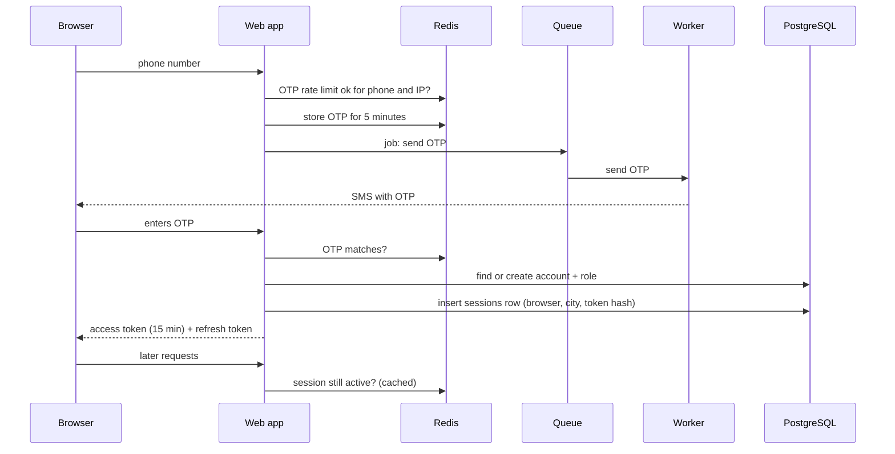

OTPs, rate limits and session checks are answered from Redis, so a rush of logins barely touches the database.

### Rules

- **OTP limits**, for example at most 3 OTPs per phone per 10 minutes, a 30-second wait before resending, and limits per IP address.
- **New users** get an `accounts` row and a `customer` role. Signing up as a dealer adds a `dealer` role, a `dealer_profiles` row and a Free `dealer_subscriptions` row.
- **Refreshing:** an expired access token is swapped for a new pair using the refresh token, and the old refresh token stops working.
- **Active sessions screen:** lists the user's sessions with browser, city and last active time. Removing one sets `revoked_at` and clears its Redis entry.
- **"Log out all other sessions"** revokes everything except the current one. Suspending an account or changing its phone revokes all of them.
- **Admins** log in on a separate admin page with email, password and two-factor, never with OTP.

## 5. Workflow: a dealer posts a property

The dealer sees "submitted" within about a second. Photos go straight from the browser to S3, and resizing and checks happen in the background.

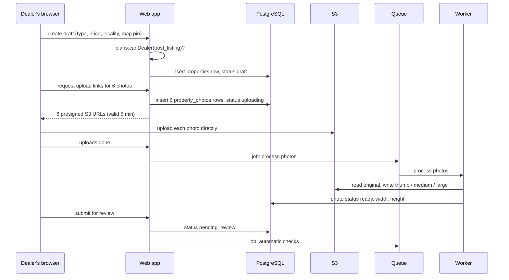

The web app only writes small rows and hands out upload links. Moving and resizing photo bytes happens between the browser, S3 and the workers.

### Steps and rules

1. **Limit check first.** `plans.canDealer()` confirms the dealer has room on their plan.
2. **Draft saved.** One `properties` row with status `draft`, linked to the chosen locality and map pin.
3. **Upload links.** For each photo, a `property_photos` row is created with status `uploading`, and a presigned URL is returned. The URL is limited to that exact S3 key, an allowed file type (JPEG, PNG, WebP, HEIC) and a size limit (for example 10 MB).
4. **Direct upload.** The browser sends each file to S3. A failed upload is retried with a fresh link.
5. **Processing.** A worker creates resized WebP versions, strips location data from the files for privacy, records width and height, and marks each photo `ready`, or `failed` if the file is unusable.
6. **Submit.** The status moves to `pending_review`, and an automatic-checks job runs (section 8).
7. **Go live.** Clean listings become `active` with an `expires_at` date, the listing cache is refreshed, and the dealer is notified by SMS or email.

**Abandoned uploads** are removed by the 24-hour S3 lifecycle rule, and a nightly job deletes `property_photos` rows stuck in `uploading`.

## 6. Workflow: a customer searches and browses

Searching and browsing make up about 85% of Propzen's traffic. At launch, searches run on PostgreSQL using indexes, repeated searches and listing pages come from Redis, and photos load straight from S3.

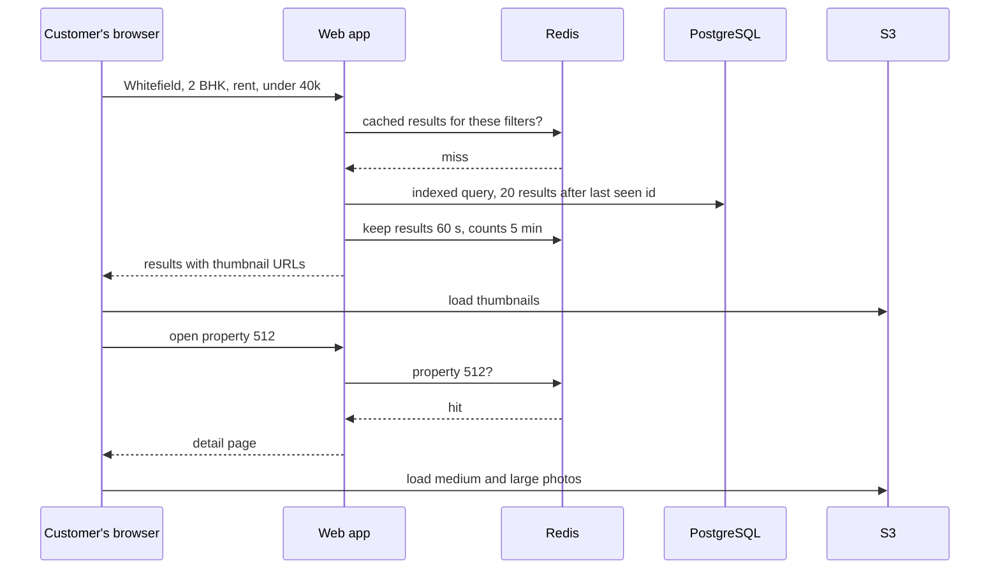

The first person to run a search or open a listing costs one database query. Everyone after them for the next minute gets the cached copy.

### How it stays fast

| Technique | What it does |
| --- | --- |
| Composite index on status, locality, purpose, type, price | Filter searches read only matching rows |
| Spatial index on `location` | Map view and "near me" search without scanning the whole table |
| "Load more" paging by last-seen id | No slow "skip 10,000 rows" queries; deep paging is capped |
| Cached search results (about 60 s) and filter counts (about 5 min) | Repeated searches skip the database |
| Cached property details (about 10 min) | Refreshed whenever the property's `updated_at` changes |
| Thumbnails only in result lists | Light pages; large photos load only on the detail page |
| Long browser caching for photos | Photo keys never change, so returning visitors reuse photos already downloaded |
| Locality list cached in Redis | Suggestions as you type rarely reach the database |

Results are sorted by a simple score that combines freshness, photo count and dealer verification.

## 7. Workflow: a customer contacts a dealer

Creating a lead takes one quick database write, and the dealer is notified in the background. Double taps, network retries and repeat enquiries never create duplicate leads.

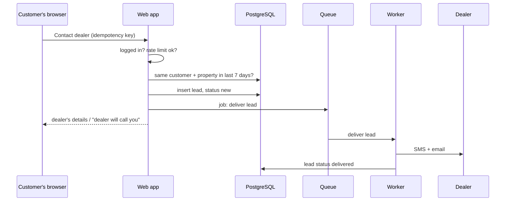

The lead is saved with status `new` before any message is sent. A small sweeper job re-queues any lead still `new` after a couple of minutes, so a saved lead is always delivered, even if the server restarts right after saving it.

### Rules

1. **Logged-in customers only.** Logging in proves the phone number through OTP.
2. **Same tap, same lead.** A repeated `idempotency_key` returns the earlier result instead of creating a second lead.
3. **Repeat enquiries.** If the same customer contacted the same property in the last 7 days, the existing lead is shown again.
4. **Rate limits.** For example, at most 20 leads per customer per hour, to stop spam and scraping of dealer contacts.
5. **Delivery with retries.** Failed SMS or email is retried with growing gaps, and the lead's status records the outcome.
6. **Dealer inbox.** Dealers see their leads newest first, served by the (`dealer_id`, `created_at`) index.

## 8. Workflow: moderation, lifecycle and expiry

Automatic checks approve most listings within seconds, and only doubtful ones wait for an admin. Listings expire on a schedule, so Propzen doesn't fill up with sold flats.

### Listing lifecycle

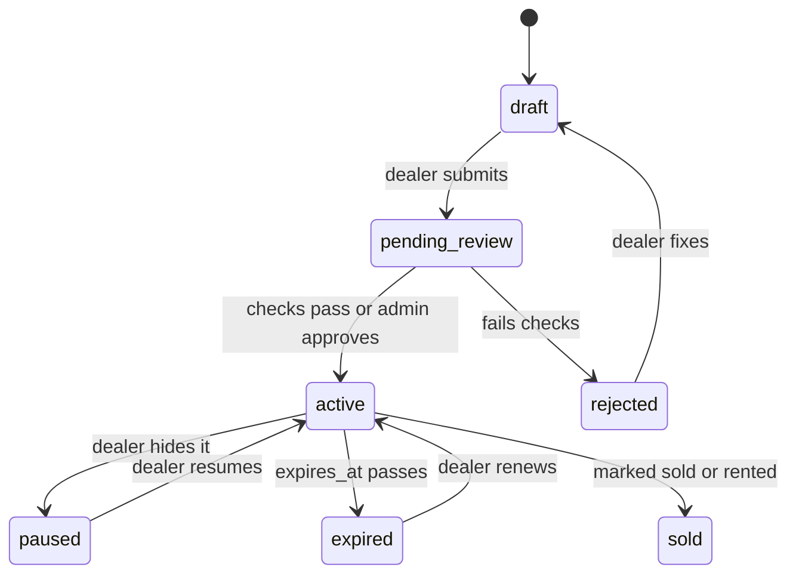

Only these status changes are allowed; the Listings module refuses any other.

### Review flow

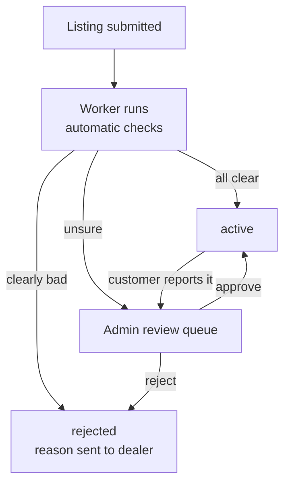

Approved listings get `reviewed_by` and an `expires_at` date. Customer reports ("already sold", "fake") send an active listing back to the queue.

### Automatic checks

| Check | Result if it fails |
| --- | --- |
| Price far outside the normal range for that locality and type | Admin review |
| Dealer's phone on a block list | Rejected |
| Contact details written in the description | Admin review |
| No `ready` photos | Waits until photos finish |
| Too many listings posted in a short time | Admin review |

### Scheduled jobs (run by the workers)

- **Nightly expiry:** active listings past `expires_at` move to `expired`, a few hundred at a time, so the table is never locked for long.
- **Reminders:** dealers get a "still available?" SMS or email a few days before expiry.
- **Renewal:** sets a new `expires_at` and returns the listing to `active`, if the plan has room.
- **Cleanup:** removes `property_photos` rows stuck in `uploading`, and re-queues leads stuck in `new`.

## 9. Launch scope and principles

With the database and workflows in place, these are the infrastructure choices Propzen launches with. The next section shows how they fit together.

| Decision | Launch choice |
| --- | --- |
| Platform | Web application only |
| Servers | One app server running the web app, background workers and Redis |
| Database | Managed PostgreSQL with automatic backups, kept off the app server |
| Photos | Amazon S3, uploaded directly from the browser |
| Queue | SQS or Kafka (SQS recommended to start) |
| Monitoring | None at launch; application logs are still stored (CERT-In requires 180 days in India) |
| Load target | 500+ concurrent customers, dealers and admins |
| Hosting region | India (AWS Mumbai) |

### Principles

- **Read-heavy by design.** About 95% of traffic only reads, so repeated reads are answered from Redis.
- **Slow work never blocks a user.** Photo processing, SMS and email run in background workers.
- **Photo files never pass through the app.** The browser uploads straight to S3.
- **The database is the single source of truth.** Everything in Redis is a temporary copy that can be rebuilt.
- **Built to grow without rewrites.** Sessions and caches live in Redis rather than server memory, so adding a second server later only needs a load balancer in front.

## 10. Launch architecture

At launch, everything Propzen runs sits on one server. Data lives in managed PostgreSQL, photos in S3, and slow jobs pass through a queue. Nothing in this diagram is optional at launch; everything that can wait is covered in section 13.

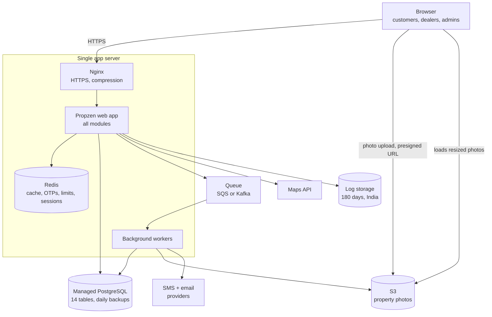

The browser talks to one server for pages and data, and talks directly to S3 for photos. Inside the server, the web app answers quickly and hands slow jobs to the workers through the queue.

### Components

| Component | Where it runs | What it does |
| --- | --- | --- |
| Nginx | App server | Accepts HTTPS, compresses responses, passes requests to the app |
| Propzen web app | App server | Runs all modules: login, listings, photos, search, leads, plans, admin |
| Background workers | App server, as separate processes | Photo resizing, SMS and email, lead delivery, expiry jobs |
| Redis | App server | Caches searches and listings, stores OTPs, rate-limit counters and active-session checks |
| PostgreSQL | Managed service (Amazon RDS) | All 14 tables; automatic backups and point-in-time restore |
| Queue | SQS (managed) or Kafka | Holds jobs until a worker picks them up |
| S3 | AWS | Original and resized property photos |
| SMS + email providers | External | OTPs and lead alerts (SMS needs DLT registration) |
| Maps API | External | Map pin when posting a property |
| Log storage | AWS | Keeps application logs for 180 days in India |

A process manager (such as systemd or PM2) restarts the app and workers automatically if they crash.

### How photos are stored and served at launch

- **Uploads use presigned URLs:** a one-time link, valid for about 5 minutes, that lets the browser upload one file to one exact S3 location.
- **The database stores the S3 key, not a full URL**, for example `properties/512/photos/9f3c.../original.jpg`. The app builds photo URLs from the key.
- **Originals stay private.** Only the resized web versions (`thumb.webp`, `medium.webp`, `large.webp`) are publicly readable, through an S3 bucket policy limited to that prefix.
- **Each photo gets a new key and is never overwritten**, so browsers can cache photos for a long time.
- **Unfinished uploads are deleted after 24 hours** by an S3 lifecycle rule.

Because only keys are stored, putting a CDN in front of S3 later changes only the URL the app builds, with no data migration.

## 11. Modules

The web app is one codebase split into eight modules. Each module owns its tables and offers functions to the others, such as `listings.getById()`; no module reads another module's tables directly. This keeps the code organised, and any module can later move into its own service along a boundary that already exists.

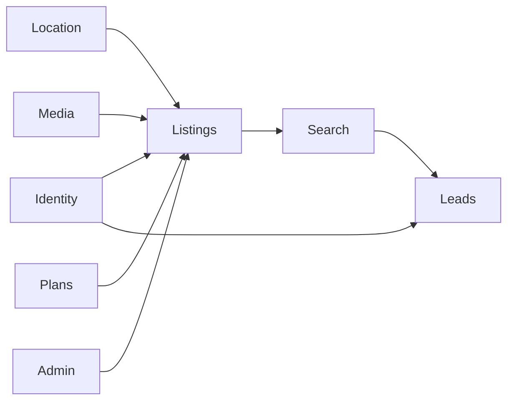

A verified account (Identity) creates a listing in a locality (Location), with photos (Media), within its plan limit (Plans). Admins review it, Search shows it, and a customer's enquiry becomes a lead.

| Module | Owns these tables | Main jobs |
| --- | --- | --- |
| Identity | accounts, account_roles, customer_profiles, dealer_profiles, sessions | OTP login, roles, profiles, active sessions |
| Admin | admins | Staff login with password and two-factor, review queue |
| Location | states, cities, localities | Master list of places, locality suggestions |
| Listings | properties | Create, edit, status lifecycle, expiry |
| Media | property_photos | Presigned uploads, resizing, ordering, cover photo |
| Search | none (reads properties) | Filters, sorting, map search, filter counts |
| Leads | leads | Contact dealer, duplicate blocking, delivery tracking |
| Plans | plans, dealer_subscriptions | Free plan by default, limits, the single "can this dealer do X?" check |

Notifications (SMS and email) are a shared service run by the background workers and own no tables.

## 12. Handling 500+ concurrent users on one server

A single 4-core, 8 GB server can serve Propzen's estimated 500-user peak, as long as the database is indexed, repeated reads come from Redis, and slow work stays in the workers. The cost of starting with one server is lower headroom and no redundancy, not lack of capacity.

| Step | Estimate |
| --- | --- |
| Users active at once | 500 |
| One click per user | About every 15 seconds |
| Average load | About 130 requests per second |
| Peak load (3× average) | About 400 requests per second |
| Share that only reads | About 95% |

These are planning estimates. A load test before launch, with 500 simulated users doing a realistic mix of searching, viewing, enquiring and posting, replaces them with measured numbers.

### What keeps one server fast

- **Indexes** on every busy query (section 3).
- **Redis caching** for searches, filter counts, listing pages, locality lists, session checks and plan limits.
- **Photos served by S3**, never through the app.
- **Background workers as separate processes**, so photo processing or SMS never holds up a page.
- **Rate limits** on OTPs, searches, leads and upload links, so a single abuser can't consume the server.
- **A process manager** that restarts the app or workers within seconds if one crashes.

### Trade-offs accepted at launch

| Trade-off | Effect | Mitigation now |
| --- | --- | --- |
| One server, no redundancy | Brief downtime if it crashes or during deploys | Auto-restart; deploy at quiet hours; database is separate and backed up |
| No monitoring | Problems are noticed when users report them | Logs are stored (180 days, CERT-In), so issues can be investigated afterwards |
| Redis on the app server | Cache is lost if the server restarts | Only temporary data lives there; it refills automatically |
| Workers share the server's CPU | Heavy photo batches could slow pages slightly | Limit how many photo jobs run at once |

## 13. Needed now vs added later

Propzen launches with ten services. Everything else waits until a clear signal appears; add each one when its signal shows up, not because large portals use it.

### Needed at launch

| Service | Purpose |
| --- | --- |
| One app server (4 cores, 8 GB) with Nginx | Runs the web app and background workers |
| Managed PostgreSQL with automatic backups | Source of truth for all 14 tables |
| Redis (on the app server) | OTPs, rate limits, session checks, caching |
| Queue: SQS or Kafka | Hands slow work to the workers; SQS is simpler to start |
| S3 | Property photos |
| SMS provider with DLT registration | OTP login and lead alerts |
| Email provider (such as Amazon SES) | Lead copies and receipts |
| Maps API | Map pin when posting a property |
| Secrets manager | Keeps passwords and API keys out of the code |
| Log storage | Application logs kept 180 days in India (CERT-In) |

### Add later: servers and infrastructure

| Add | Signal to add it |
| --- | --- |
| Second app server + load balancer | CPU regularly above about 60%, deploy downtime becomes a problem, or paying dealers expect uptime |
| Workers on their own server | Photo processing or notifications start slowing pages |
| Managed Redis | More than one app server needs to share the cache |
| Connection pooler (PgBouncer) | Several servers share the database |
| Basic monitoring + error tracking (CloudWatch, Sentry) | The first outage you hear about from a user, or the first paying dealers |
| Infrastructure as code (Terraform) | Before adding a second server or a staging environment |
| Containers (ECS / Fargate) | Deploys get painful, or you run several services |
| Kubernetes | Many services and a larger team; often never needed |
| Microservices | One module needs to scale or deploy on its own, such as search |
| Multi-region setup | Downtime becomes very costly |

### Add later: delivery and protection

| Add | Signal to add it |
| --- | --- |
| CDN (CloudFront) | Photo traffic grows, users spread beyond one city, or SEO pages launch |
| Firewall / bot protection (AWS WAF) | Scraping or bot traffic appears |

### Add later: search and data

| Add | Signal to add it |
| --- | --- |
| Search engine (OpenSearch) | Several hundred thousand listings, or search slower than 500 ms with good indexes |
| Database read replicas | Database CPU regularly above about 60% |
| Table partitioning | Leads or sessions reach tens of millions of rows |
| BI dashboards (Metabase) | The team keeps asking engineers for numbers |
| Data warehouse | Analytics too heavy even for a replica |
| Product analytics (PostHog, Mixpanel) | You want to see where users drop off |

### Add later: messaging

| Add | Signal to add it |
| --- | --- |
| Kafka (if you start with SQS) | Many systems need the same events at very high volume |
| WhatsApp Business API | Dealers ask for leads on WhatsApp |
| Real-time chat (WebSockets) | You want customer–dealer chat inside Propzen |

### Add later: product features

| Add | Signal to add it |
| --- | --- |
| Payment gateway (Razorpay, Cashfree) | You launch paid plans |
| Feature flags | You want to release features to some users first |
| A/B testing | Traffic is high enough for results to mean something |
| Smarter ranking | Months of search and click data |
| Duplicate listing detection | Customers see the same flat many times |
| Automatic image moderation | Manual photo review takes too much time |
| Video tours | Dealers want to upload video |
| Multiple languages | You expand beyond English-first users |
| Support desk | Support email becomes unmanageable |

## 14. Growth path and open decisions

Propzen grows in five stages, and each stage plugs into the launch design without rewrites. Sessions and caches already live in Redis, photos in S3 under stored keys, and slow work behind a queue.

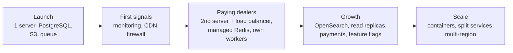

Each arrow is crossed only when that stage's signals from section 13 appear, not on a calendar.

### Planned features (not in the launch schema)

| Feature | What it does | Adds later |
| --- | --- | --- |
| Achievements and badges | "First sale," "10 sales," "First home found," "One year with us," shown on profiles for recognition only | `achievements`, `earned_achievements` |
| Extra listings beyond the plan limit | When a dealer hits the limit, they wait for a free slot or pay to post one more now | An extra-listings credit ledger |

The launch schema already records what both need (account creation date, last login, sold date).

### Open decisions

- [ ] Queue: SQS or Kafka for launch?
- [ ] Cooldown model: a monthly quota that resets, or a fixed number of live listings with slots that free up?
- [ ] Are brokers mostly solo, or agencies with several agents? Agencies would need an organizations table.
- [ ] Will dealers pay by subscription, per lead, or both?
- [ ] Do individual owners need their own role, or are they dealers on the Free plan?
- [ ] What counts as an "active" account for the one-year badge?
- [ ] Add a `consents` table to record DPDP consent before launch?
- [ ] Add RERA number and QR fields for builder project listings in states that require them?
